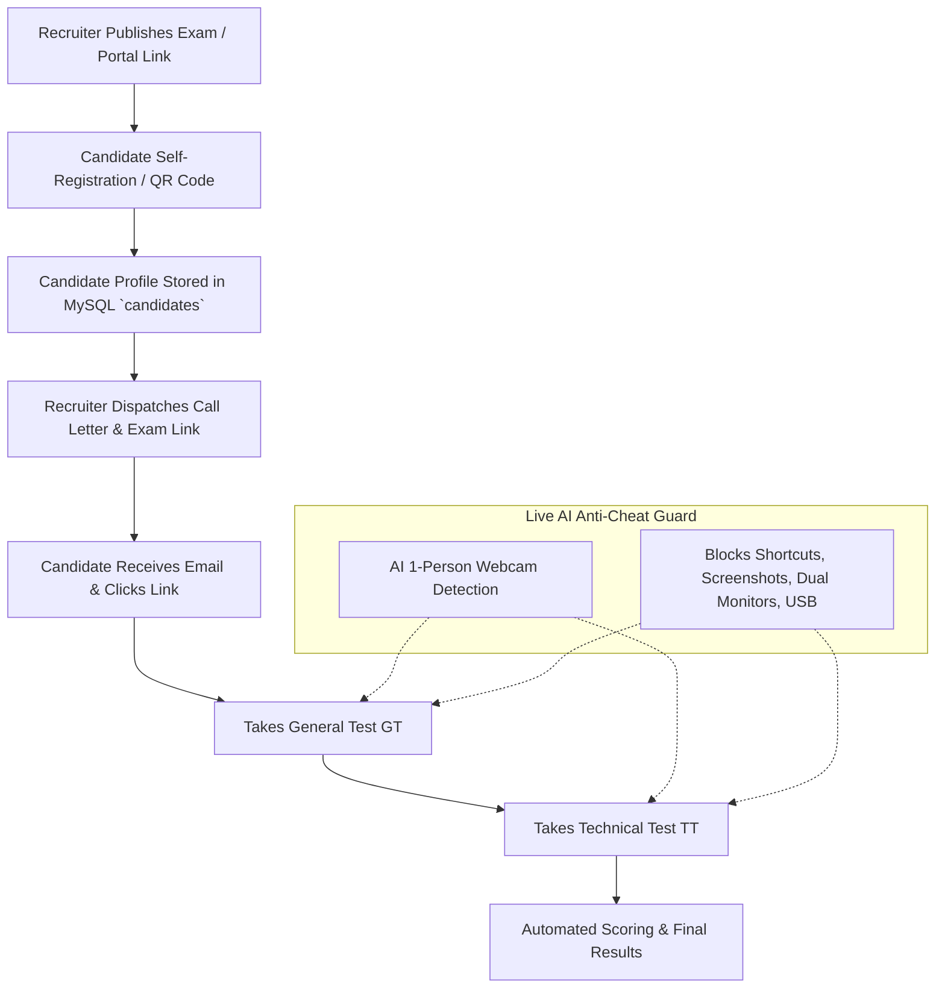
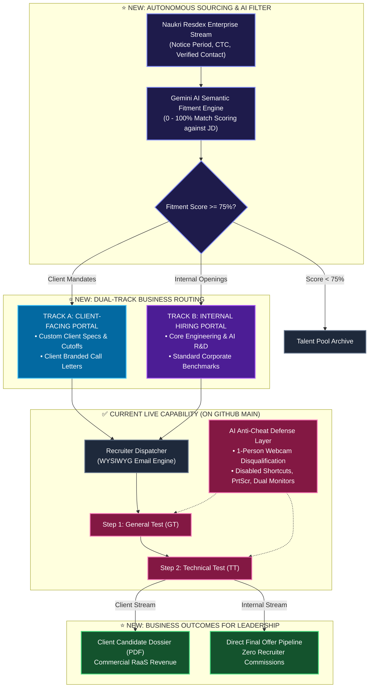

# INTELLIGENZ IT — EXECUTIVE TRANSFORMATION DOSSIER
**Topic:** Current Production Architecture vs. Next-Generation AI Dual-Track Platform  
**Target Audience:** Chief Executive Officer (CEO) & Executive Leadership Team  
**Author:** Technical Engineering & Product Architecture Team  
**Date:** November 2026  

---

## 1. Executive Summary: The Business Transformation

```
┌──────────────────────────────────────────────────────────────┐
│  Phase 1: Existing System (Currently Live on GitHub `main`)   │
│  • Manual Sourcing & Inbound Self-Registration               │
│  • Single-Stream Candidate Database & Invite Engine          │
│  • General & Technical Assessment Engine                     │
│  • AI Webcam Proctoring (1-Person Detection & Anti-Cheat)    │
└──────────────────────────────┬───────────────────────────────┘
                               │
                               ▼ [Strategic Value Add]
┌──────────────────────────────────────────────────────────────┐
│  Phase 2: New Architecture (Target Expansion for CEO)        │
│  • Automated Sourcing from Naukri (Instant CV Ingestion)     │
│  • Gemini AI Semantic Fitment Screening (0–100% Score)       │
│  • Dual-Track Separation:                                    │
│    - Track A: Client-Facing Recruitment-as-a-Service (RaaS)  │
│    - Track B: Internal Intelligenz IT Core Hiring            │
│  • Automated Executive Dossier & Offer Pipeline Generation   │
└──────────────────────────────────────────────────────────────┘
```

---

## 2. Section I: What We Have Built (Current Live System on GitHub `main`)

The existing codebase on GitHub (`origin/main`) is fully built and operational with a connected **MySQL database** and **Django backend**:

### A. Core Modules in Live Operation:
1. **Candidate Lifecycle & Registration (`home/users`):**
   * QR code-based and direct link onboarding.
   * Dynamic qualification checks (swapping CGPA / Percentage).
   * Verified contact capture with international dialing codes.

2. **Recruiter Command Center (`user_invite` & `home/users`):**
   * **Visual WYSIWYG Email Template Builder:** Recruiters write formatted emails like Word/Gmail without raw HTML code.
   * **1-Click Call Letter & Exam Link Loaders:** Direct insertion of dynamic variables (`{{ user.first_name }}`, `{{ user.confirmation_url }}`, etc.).
   * **Clean Navigation:** Consolidated `Candidate Invites` and `Email Templates` directly within the **Manage Candidate** console.

3. **Secure Testing & Anti-Cheat Proctoring (`Exam_dashboard`):**
   * **Step 1:** General Aptitude Test (GT).
   * **Step 2:** Technical Coding Test (TT) with live code runner.
   * **Strict AI Anti-Cheat Engine:**
     * **1-Person Rule:** If 2 or more people appear in the camera, the candidate is **instantly disqualified** and redirected to their profile.
     * **Locked Re-Entry:** Disqualified candidates are blocked in the MySQL database from restarting or retaking exams.
     * **Browser Defense:** Shortcuts (`Ctrl+T`, `Ctrl+N`, `Alt+Tab`, `F12`), Screenshots (`PrtScr`, Snipping Tool), DevTools, Dual Monitors, and External USB/Audio peripherals are blocked.

### B. Current Workflow Diagram (Live on `main`):



---

## 3. Section II: What We Are Building Next (The New Strategic Architecture)

To eliminate manual recruiter hunting and monetize the portal for external client staffing, we are introducing **AI-Powered Naukri Ingestion** and **Dual-Track Workflow Separation**:

### A. Autonomous Sourcing from Naukri:
* Directly ingests real-time active Indian IT candidates.
* Extracts structured parameters: **Verified Mobile, Email, Current CTC, Expected CTC, Notice Period, and Resumes**.

### B. Gemini AI Semantic Matcher (Pre-Screening):
* Evaluates project depth, technical skills, and experience against the Job Description.
* Assigns an exact **Fitment Score (0–100%)**.
* Profiles below threshold (e.g. 75%) are archived in a general talent pool. Profiles above 75% are automatically fast-tracked.

### C. Dual-Track Separation (Clients vs. Internal):

| Feature | Track A: Client-Facing Recruitment Portal | Track B: Internal Intelligenz IT Hiring |
| :--- | :--- | :--- |
| **Objective** | Fulfill client staffing contracts & client hiring drives | Internal R&D, AI Engineers, QA, and Leadership |
| **Branding & Specs** | Client-specific requirements, custom cutoffs, client-branded call letters | Intelligenz IT standard corporate bands & culture benchmarks |
| **End Output** | **Shareable Client Candidate Dossier (Executive PDF)** with scores & code snippets | **Internal Offer Pipeline** & direct technical interview scheduling |
| **Business Value** | **Generates revenue** as a digital Recruitment-as-a-Service (RaaS) platform | **Slashes agency fees by 100%** and cuts time-to-hire to 15 minutes |

---

## 4. Master Comparative Architecture (Existing vs. Next-Gen)



---

## 5. How to Present This to the CEO (Step-by-Step Pitch Script)

When presenting to your CEO, follow this 4-step strategic pitch:

### Step 1: Show the Live Achievement (Confidence Builder)
> *"CEO Sir/Ma'am, our core platform on GitHub `main` is completely built and operational. We have our MySQL database, Django backend, visual email builders, and an AI proctoring system that instantly disqualifies anyone if a second person enters the webcam frame or if they try to cheat using shortcuts or secondary screens."*

### Step 2: Highlight the Inefficiency We Are Solving
> *"Right now, recruiters still have to manually find candidates on job portals. Sourcing and scheduling takes 5 to 7 days per hire, costing substantial recruiter hours and agency fees."*

### Step 3: Present the Next-Generation Solution (The Diagram)
> *"By integrating **Naukri Automated Sourcing** with **Gemini AI Screening**, the platform will autonomously find CVs on Naukri, score them against our Job Description, and auto-dispatch exam links to candidates who score above 75% within 15 minutes."*

### Step 4: Show the Two Business Streams (The Revenue Pitch)
> *"We are splitting the system into two distinct profit drivers:*
> 1. ***Client-Facing Portal:*** *We assess and screen candidates for external clients, delivering ready-to-hire candidate dossiers as a revenue-generating service.*
> 2. ***Internal Intelligenz IT Portal:*** *We hire our own top 1% software engineers with zero recruitment agency commissions."*

---

## 6. Executive ROI Summary Table

| Metric | Traditional Recruitment | Current Live Portal | Target Dual-Track AI Platform |
| :--- | :--- | :--- | :--- |
| **Sourcing Method** | Manual searches on Naukri | Recruiter invites / Inbound | **Autonomous Naukri Ingestion** |
| **Resume Screening** | Manual reading by HR | Manual review | **Gemini AI Instant Scoring (0-100%)** |
| **Time to Schedule** | 3 to 5 business days | 1 business day | **Instant (< 15 Minutes)** |
| **Anti-Cheat Security** | None / Honor system | **AI 1-Person Webcam & System Lock** | **AI 1-Person Webcam & System Lock** |
| **Client Deployment** | Manual spreadsheets | None | **Dedicated Client Stream & PDF Dossiers** |
| **Cost Per Hire** | ₹40,000 – ₹75,000 | ₹15,000 | **< ₹3,000 (85%+ Cost Reduction)** |
